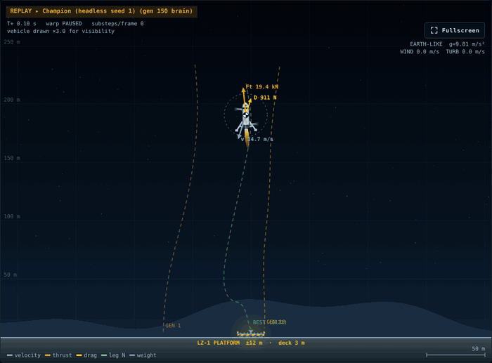
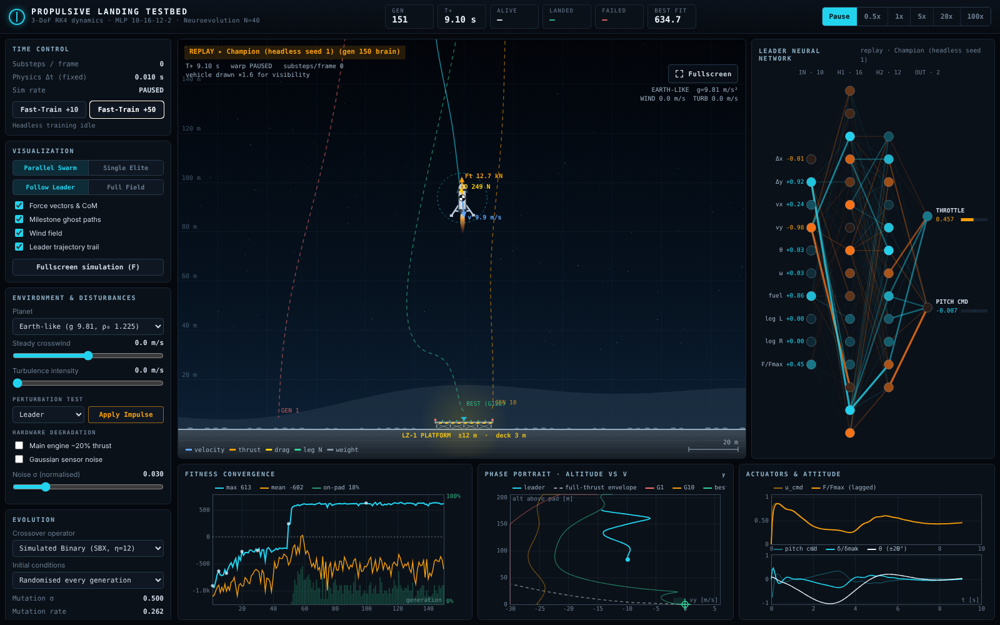
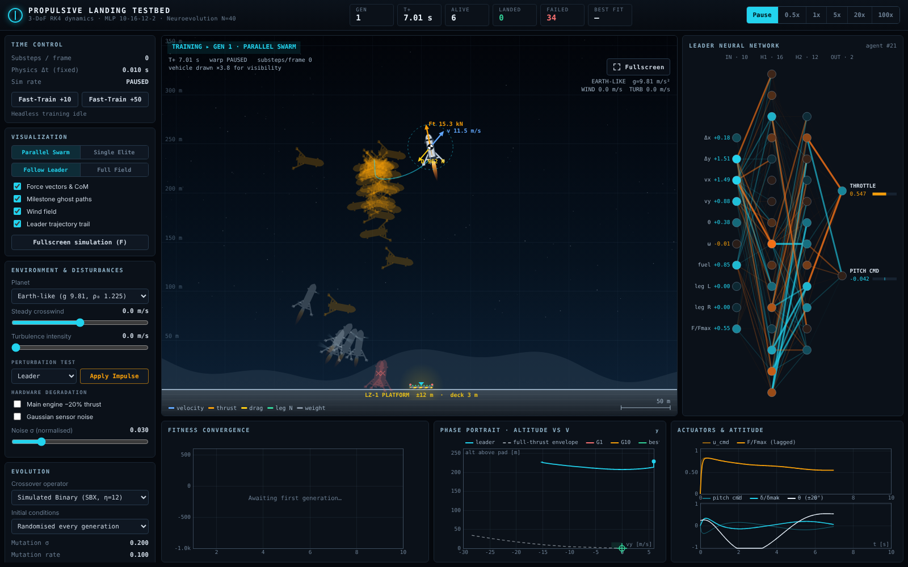
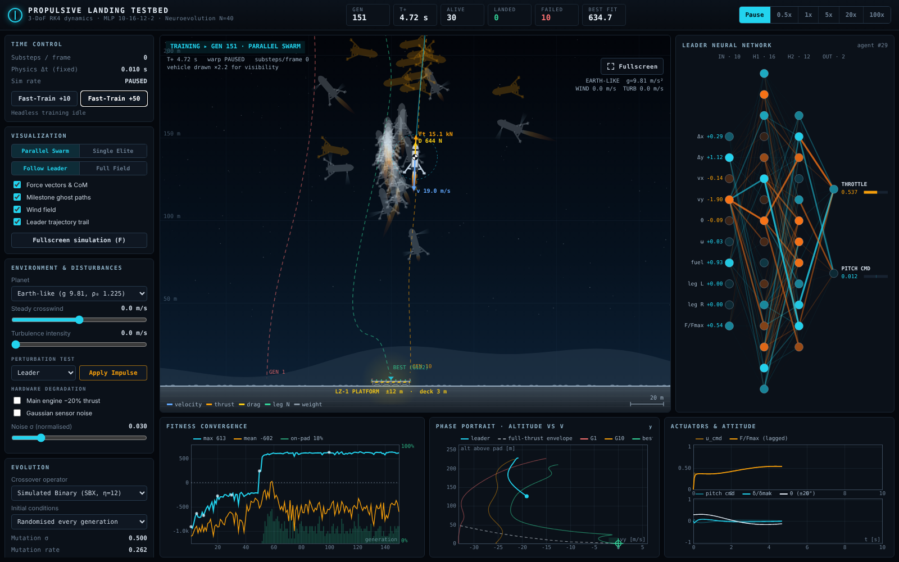

# Propulsive Landing Testbed

**A population of neural-network pilots learns, from scratch, to land a gimballed rocket on a
raised platform.** The simulator uses RK4 rigid-body dynamics with variable mass, actuator lag,
drag in wind and spring-damper legs; the controllers are evolved with a genetic algorithm. It is
dependency-free JavaScript: open `index.html` and it runs.



<sub>The evolved champion of one training run, replayed at 2x speed. Cyan: velocity, orange: thrust,
yellow: drag; dashed lines are the best flights of earlier generations.</sub>

## Results at a glance

| | |
|---|---|
| Controller | MLP 10-16-12-2 (tanh), 406 evolved weights, 50 Hz |
| Physics | 3-DoF, RK4 at a fixed 10 ms step, variable mass and inertia |
| Training | 40 brains per generation, 150 generations ≈ 20 s headless (Node.js) |
| Calm-air landing rate | **98.5 %** on 500 unseen scenarios (mean of 5 independent training runs) |
| Touchdown | 0.2-1.1 m/s vertical speed (limit 2 m/s), typically within 0.3-2 m of the pad centre |
| Robustness | 96 % in an 8 m/s crosswind **if trained in wind**, ~59 % if not. See [honest limits](#what-the-results-do-and-do-not-show) |

Everything on this page is regenerated by the scripts in this repository (see
[Reproducing the results](#reproducing-the-results)).

## Quick start

**Interactive simulator.** Open [`index.html`](index.html) in Chrome, Edge or Firefox. There is
no install, build step, server or network access involved.

1. Press **Fast-Train +50** (about 10-20 s). Repeat two or three times.
2. Watch the *Fitness Convergence* plot. The first on-pad landings usually appear between
   generation 20 and 80.
3. Click **All-Time Best** (or any checkpoint) to replay that brain; **Resume Training** returns
   to the live population.
4. Stress the result: crosswind and turbulence sliders, **Apply Impulse**, −20 % thrust,
   sensor noise, other planets. Training continues under those conditions, so the population
   adapts to them.

Keys: `Space` pause · `1`-`5` time warp · `I` impulse · `V` swarm / elite · `C` camera · `F` fullscreen.

**Command line (Node.js 18+, no dependencies).**

```bash
npm test                                   # 10 sanity tests of the physics, GA and trainer
node tools/train-headless.js --seed 1 --gens 150 --out runs/seed1
node tools/evaluate.js runs/seed1/champion.json --episodes 500 --wind 8
```

> **GitHub Pages.** Because the app is static, enabling *Settings → Pages → Deploy from branch →
> `main` / root* gives you a live demo without any build step.

## The dashboard



| Element | Meaning |
|---|---|
| Faded vehicles | All 40 brains of the generation (green: landed, red: crashed, orange: lost / timeout) |
| Bright vehicle | Current leader; the network panel and plots follow it |
| Arrows | blue velocity, orange thrust, yellow drag, green leg reaction, grey weight; the chequered circle is the centre of mass |
| Dashed paths | Best flights of Gen 1, Gen 10 and the all-time best: visual evidence of learning |
| *Leader Neural Network* | Line thickness = live signal \|w·a\|, cyan positive, orange negative |
| *Fitness Convergence* | cyan best, orange mean, green bars = share of brains landing on the pad |
| *Phase Portrait* | altitude vs vertical speed; the dashed curve is the full-thrust ("suicide burn") envelope |
| *Actuators & Attitude* | throttle command vs lagged thrust, pitch command, gimbal angle, tilt |

<details>
<summary>Generation 1 vs. a trained population</summary>




</details>

## Engineering overview


The detailed derivations, worked numerical examples and design notes are in the
**[Engineering Guide](docs/ENGINEERING.md)**. The essentials:

**Physics.** State $s=[x,y,v_x,v_y,\theta,\omega,m_\text{fuel},F,\delta]$ integrated with classical
RK4 at $\Delta t=10$ ms.

- Variable mass, $\dot m=-F/(I_{sp}g_0)$, and inertia $I=m(3r^2+h^2)/12$
- Thrust-vector control ($\pm8^\circ$ gimbal) plus cold-gas RCS; first-order lags of 50 ms (throttle) and 80 ms (gimbal)
- Exponential atmosphere, quadratic drag on the *relative* velocity, a 1/7-power-law wind profile plus gusts, and an aerodynamic torque from an offset centre of pressure
- Spring-damper legs with regularised Coulomb friction ($\tanh$ instead of $\mathrm{sgn}$, which keeps RK4 stable) on a raised 3 m platform with side walls
- *Time warp never changes $\Delta t$*; it only runs more fixed steps per frame

**Controller.** A 10-16-12-2 tanh MLP maps normalised sensors (position error, √-scaled altitude,
velocities, attitude, fuel, leg contacts, current thrust) to a throttle and a pitch command.
The same pitch command drives the gimbal and the RCS pods.

**Learning.** A genetic algorithm over the 406 weights:

- 4 elites copied unchanged, tournament selection (k = 5), SBX or uniform crossover
- Adaptive Gaussian mutation that widens on fitness plateaus
- Selection fitness is the mean of each genome's last 5 episodes, so lucky flights do not survive
- LQR-style running cost with a gain-scheduled velocity weight, plus terminal rewards graded per
  failure mode (reward shaping)

### Learning curves


Best-of-generation fitness jumps once the first brains land (generation 17-76 across five runs).
The population mean stays negative because mutation keeps producing poor offspring; the useful
object is the champion, which is selected on held-out scenarios.

### Before and after training


60 random start conditions: the best brain of generation 1 (left) never lands on the pad; the trained
champion (right) funnels every start into the 24 m wide platform.


The champion does **not** perform a minimum-time suicide burn. It brakes early and descends slowly
near hover thrust (≈45 % throttle), staying at about a quarter of the speed allowed by the
full-thrust envelope. The reward favours a safe touchdown far more than saving fuel or time, and
evolution found exactly that. See [§7.1 of the guide](docs/ENGINEERING.md#71-behaviour-of-the-trained-brain).

### Robustness


| Condition (500 unseen scenarios, mean of 5 runs) | Trained in calm air | Trained in 8 m/s wind + 3 m/s gusts |
|---|---|---|
| Calm air | **98.5 %** | 62.9 % |
| 8 m/s crosswind | 58.8 % | **95.9 %** |
| 8 m/s wind + 3 m/s turbulence | 53.9 % | **95.6 %** |
| 20 % thrust loss | 59.6 % | 15.7 % |
| Sensor noise σ = 0.03 | 98.5 % | 56.8 % |
| Sensor noise σ = 0.10 | 92.5 % | 42.2 % |
| Mars gravity | 0 % | 5.0 % |

### What the results do and do not show

- Evolved controllers are **specialists**. Each one is excellent on the distribution it was trained
  on and brittle outside it (calm-air brains fail in crosswind in 2 of 5 runs; wind-trained brains
  lose accuracy in calm air). Training on a random mix of conditions is the obvious next step and
  has not been done here.
- Run-to-run variance is large (individual runs span 0-100 % in the wind test), which is why every
  figure is an average of five independent runs.
- The scenario seed for evaluation (`424242`) is never used for training or champion selection,
  but the benchmark is still a simulation: nothing here has been validated against a real vehicle.
- The model is planar (3-DoF), with lumped aerodynamics and no sloshing or engine start-up transient.

## Reproducing the results

```bash
# 1. Train five calm-air runs and five wind runs (≈ 20 s each)
for s in 1 2 3 4 5; do
  node tools/train-headless.js --seed $s --gens 150 --out docs/data/seed$s
  node tools/train-headless.js --seed $s --gens 150 --wind 8 --turbulence 3 --out docs/data/windseed$s
done

# 2. Evaluate every champion on 500 unseen scenarios per condition  -> docs/data/benchmark.json
node tools/benchmark.js

# 3. Redraw all figures in docs/images   (needs Python 3, numpy, matplotlib)
python3 tools/make_figures.py
```

Training is deterministic for a fixed seed (this is covered by a test). The screenshots and the GIF
were captured from the real app in headless Chromium; they are not regenerated by the scripts above.

## Repository layout

| Path | Contents |
|---|---|
| `index.html`, `css/style.css` | Dashboard and dark mission-control theme |
| `js/config.js` | **All tunable constants**: planets, vehicle, rules, fitness weights, GA, scenario envelope |
| `js/rng.js` | Seeded Mulberry32 PRNG + Gaussian sampling |
| `js/environment.js` | Gravity, atmosphere, wind and gusts |
| `js/physics.js` | 3-DoF dynamics, RK4, contact kinematics |
| `js/neural.js` | MLP with a flat genome, forward pass, activation capture |
| `js/evolution.js` | Elitism, tournament, SBX / uniform crossover, adaptive mutation |
| `js/simulation.js` | Trainer: sensing, cost, terminal events, generations, checkpoints, replay |
| `js/canvasutil.js`, `renderer.js`, `nnviz.js`, `plots.js`, `ui.js`, `main.js` | Rendering, plots, controls, render loop |
| `tools/` | Headless training, evaluation, benchmark, figure generation |
| `test/` | Node.js test suite (`npm test`) |
| `docs/ENGINEERING.md` | Derivations, worked examples, design notes, experiments |
| `docs/data/` | Trained champions (`champion.json`), per-generation histories, `benchmark.json` |
| `docs/images/` | Figures, diagrams, screenshots, GIF |

The simulation core (`config.js` → `simulation.js`) has no DOM dependency, so the browser and Node
share exactly the same code.

## Tuning

Everything lives in [`js/config.js`](js/config.js):

- `SCENARIO`: initial-condition envelope (narrow it for faster early learning)
- `FITNESS`: cost weights and terminal rewards (try `crashAngle`, `fuelBonus`)
- `GA`: population size, mutation limits, tournament size, crossover operator
- `VEHICLE`: mass, thrust, Isp, gimbal limit, leg stiffness and damping
- `PLANETS`: add your own gravity / atmosphere

The [engineering guide](docs/ENGINEERING.md#8-experiments-to-try) lists six experiments to run.

## Ideas for extension

- Train on a random mixture of wind, thrust and noise conditions and compare against the specialists
- Add a time and fuel penalty to reproduce a true suicide-burn profile
- Compare with a hand-tuned PID / LQR baseline on the same benchmark
- Load a saved `champion.json` into the browser for replay (currently a CLI-only artefact)
- Extend to 6-DoF or add a moving (sea) platform

## License

[MIT](LICENSE)
