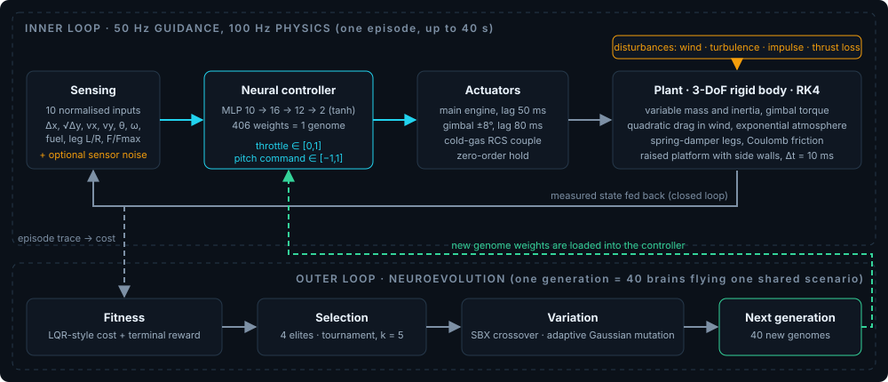
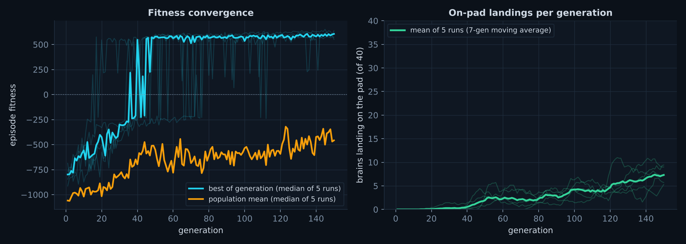
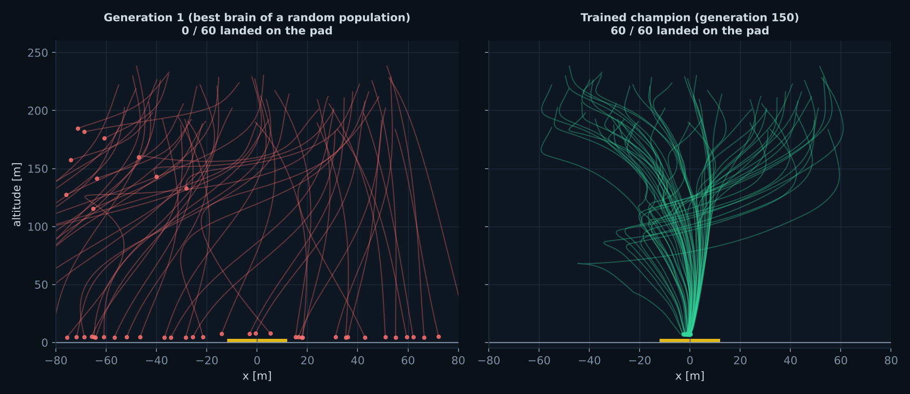
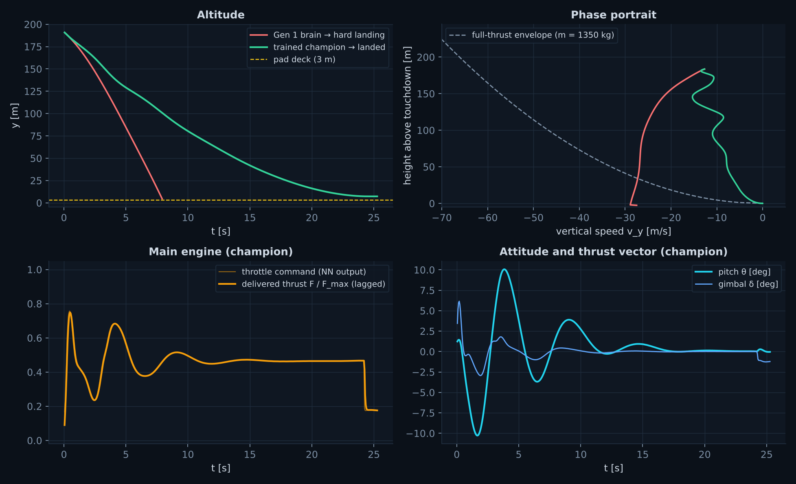
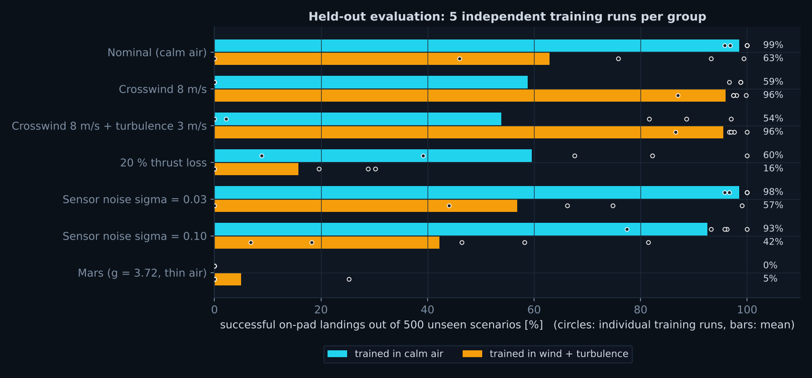

# Engineering Guide

How the Propulsive Landing Testbed works, from the equations of motion to the evolutionary
loop. Every number below is taken from [`js/config.js`](../js/config.js) (default settings) or
was measured with the scripts in [`tools/`](../tools); if you change the configuration, the
worked examples change with it.

**Contents**

1. [The problem](#1-the-problem)
2. [Physics model](#2-physics-model)
3. [Numerical integration](#3-numerical-integration)
4. [Control-theory view](#4-control-theory-view)
5. [The neural controller](#5-the-neural-controller)
6. [Neuroevolution](#6-neuroevolution)
7. [Results and what the brains actually learn](#7-results-and-what-the-brains-actually-learn)
8. [Experiments to try](#8-experiments-to-try)
9. [Known limitations](#9-known-limitations)

---

## 1. The problem

A 7 m tall, 1.35 t lander starts 180-240 m above the ground, up to 55 m off-centre, falling at
12-22 m/s with a few degrees of tilt and a few m/s of sideways speed. It has to touch down
vertically and gently on a **3 m high, 24 m wide platform**. This is the same class of problem
that Falcon 9 first stages, New Shepard and lunar landers solve.

What makes it hard:

- **Gravity does not forgive.** Ignite late and you hit the ground; ignite early and you run out
  of propellant (or start climbing).
- **Underactuation.** There is no sideways thruster. To translate, the vehicle must first tilt,
  let the horizontal component of thrust push it sideways, and then straighten up again.
- **Instability.** A tall slender body behaves like an inverted pendulum.
- **Lags and disturbances.** Engine and gimbal respond with a delay; wind, turbulence and sensor
  noise perturb the flight.

Nothing in the project hard-codes a control law. A neural network reads ten sensor values 50
times per second and outputs a throttle and a pitch command. The weights of that network are
found by evolution.

| Layer | Responsibility | File |
|---|---|---|
| Physics | Forces, torques, RK4 integration, contact | `physics.js` |
| Environment | Gravity, atmosphere, wind, turbulence | `environment.js` |
| Controller | MLP 10-16-12-2 | `neural.js` |
| Evolution | Selection, crossover, mutation | `evolution.js` |
| Trainer | Sensing, cost/reward, terminal events, checkpoints | `simulation.js` |
| UI | World view, network view, plots, controls | `renderer.js`, `nnviz.js`, `plots.js`, `ui.js` |

The core (`config.js` → `simulation.js`) contains no DOM code, so the same files run in the
browser and in Node.js (that is how the tests and benchmarks work).

---

## 2. Physics model

### 2.1 Three degrees of freedom

The vehicle is a rigid body moving in a vertical plane. Position $x$, altitude $y$ and pitch angle
$\theta$ are enough to describe it, hence "3-DoF". Newton's second law gives

$$m\ddot x = \sum F_x,\qquad m\ddot y = \sum F_y - mg,\qquad I\ddot\theta = \sum \tau .$$

The simulator integrates a 9-element state vector

$$s = [\,x,\; y,\; v_x,\; v_y,\; \theta,\; \omega,\; m_\text{fuel},\; F,\; \delta\,]$$

where the last two entries are the *actuator states*: the current engine thrust $F$ and the
current gimbal angle $\delta$. Treating them as states (instead of applying commands instantly)
keeps the actuator lag consistent inside every RK4 stage.

### 2.2 Variable mass and the rocket equation

$$m(t) = m_\text{dry} + m_\text{fuel}(t),\qquad \dot m_\text{fuel} = -\frac{F}{I_{sp}\,g_0} - \frac{F_\text{RCS}}{I_{sp,\text{RCS}}\,g_0},\quad g_0 = 9.80665\ \text{m/s}^2 .$$

Integrating this gives the Tsiolkovsky equation, $\Delta v = I_{sp}\,g_0\ln(m_0/m_f)$.

> **Worked example (default vehicle).** $m_\text{dry}=1000$ kg, $m_\text{fuel}=350$ kg,
> $F_\max=28$ kN, $I_{sp}=250$ s.
> Full-throttle burn rate: $28000/(250\cdot 9.807)\approx 11.4$ kg/s, so the tank lasts about
> 31 s. Total velocity budget: $\Delta v = 250\cdot 9.807\cdot\ln(1350/1000)\approx 736$ m/s.
> Hover thrust at full tank: $1350\cdot 9.81 = 13.2$ kN, i.e. a throttle of about **47 %**.
> Initial thrust-to-weight ratio at full throttle: $28000/(1350\cdot 9.81)\approx 2.1$.

### 2.3 Moment of inertia

The body is approximated by a solid cylinder (radius $r$, height $h$) rotating about a
transverse axis through its centre:

$$I(t) = \tfrac{1}{12}\,m(t)\,(3r^2 + h^2).$$

> With $r=0.95$ m, $h=7$ m: $I = 5817$ kg·m² at full tank and 4309 kg·m² when empty. The $h^2$
> term dominates, so a taller vehicle resists rotation with the square of its length.

### 2.4 Torque: thrust-vector control and RCS

Two mechanisms rotate the vehicle:

1. **Gimbaled main engine (TVC).** The nozzle swings by $\delta\in[-8^\circ,8^\circ]$. The thrust
   line now passes beside the centre of mass, with a lever arm of $L=3.5$ m.
2. **Cold-gas RCS pods** near the nose and tail. One pod fires at a time; the model applies
   only the resulting torque (no net translational force).

$$\tau_\text{net} = -F\,L\sin\delta + (F_{\text{RCS},L}-F_{\text{RCS},R})\,L_\text{RCS} + \tau_\text{aero} + \tau_\text{legs}.$$

> **Which one is stronger?** Gimbal: $28000\cdot 3.5\cdot\sin 8^\circ \approx 13.6$ kN·m, i.e.
> $\approx 2.3$ rad/s². RCS: $450\cdot 2.2 = 990$ N·m, i.e. $\approx 0.17$ rad/s². The gimbal is
> about 14 times stronger but only works while the engine burns; in free fall only RCS can hold
> attitude. The network has a single `PITCH CMD` output that drives both: $\delta_\text{cmd} =
> -\text{cmd}\cdot\delta_\max$ and the RCS pod selected by the sign of the command.

### 2.5 Actuator lag

Engines do not reach a commanded thrust instantly. First-order lags model that:

$$\dot F = \frac{F_\max\,u_\text{cmd} - F}{\tau_F},\ \ \tau_F = 0.05\ \text{s};\qquad
\dot\delta = \frac{\delta_\text{cmd}-\delta}{\tau_\delta},\ \ \tau_\delta = 0.08\ \text{s}.$$

The response is $F(t)=F_\text{target}(1-e^{-t/\tau})$: 63 % after one time constant, 95 % after
three (0.15 s). The "Actuators & Attitude" plot in the dashboard draws the command (pale line)
and the delivered thrust (bold line); the small offset between them is this lag.

### 2.6 Atmosphere, wind and drag

Air density falls off exponentially with altitude ($H\approx 8.5$ km on Earth):

$$\rho(y)=\rho_0\,e^{-y/H}.$$

Drag depends on velocity *relative to the air*:

$$\mathbf v_\text{rel}=\mathbf v-\mathbf v_\text{wind},\qquad
\mathbf F_d=-\tfrac12\,\rho\,C_d\,A\,|\mathbf v_\text{rel}|\,\mathbf v_\text{rel}.$$

The reference area $A$ blends the broadside area $2rh=13.3$ m² and the axial area $\pi r^2=2.8$
m² according to the angle of attack. Drag acts at a centre of pressure 0.6 m *above* the centre
of mass, so it also creates an aerodynamic torque that tries to tip the vehicle over.

The wind has two parts: a steady crosswind that decays towards the ground with a 1/7 power-law
boundary layer, and gusts made of four horizontal and two vertical sinusoids. The gust phases are
part of the scenario, so every vehicle in a generation and every replay sees the identical
disturbance.

> **Worked example.** A 20 m/s crosswind at sea level gives
> $F_d=\tfrac12\cdot1.225\cdot13.3\cdot20^2\approx 3.3$ kN, or 2.4 m/s² on a 1350 kg vehicle:
> a quarter of gravity.

Four planets are built in (Earth, Mars, Moon, Titan) with their own $g$, $\rho_0$ and $H$.

### 2.7 Landing legs and contact

Each leg is a spring-damper that can only push:

$$F_n=\max\!\big(0,\;k\,(y_\text{ground}-y_\text{foot}) - c\,\dot y_\text{foot}\big),\quad k=70\ \text{kN/m},\ c=8\ \text{kN·s/m}.$$

Sliding is opposed by Coulomb friction $F_f=-\mu F_n\,\mathrm{sgn}(\dot x_\text{foot})$. The sign
function is replaced by $\tanh(\dot x/0.25)$ (**regularisation**) because a true discontinuity
makes explicit integrators chatter (see §3.4).

> **Leg dynamics.** Static compression $mg/2k = 1350\cdot9.81/140000 \approx 9.5$ cm; natural
> frequency $\sqrt{2k/m}\approx10.2$ rad/s (1.6 Hz); damping ratio $\zeta = 2c/(2\sqrt{2km})
> \approx 0.58$, a well-tuned suspension that settles in a few small oscillations.

The platform is a raised 3 m deck, ±12 m wide, on flat ground. The surface height is
$y_g(x)=3$ m on the deck and 0 m elsewhere. A foot that sinks more than 0.6 m into the deck has
entered through the *side wall*; that is classified as a `PLATFORM COLLISION`, not a spring contact.

### 2.8 TWR and g-load

$\text{TWR}=F/(mg)$. $\text{TWR}>1$ means the vehicle can climb or brake, $\text{TWR}=1$ hover.
Here it starts at about 2.1 at full throttle. The g-load shown in the telemetry is the
non-gravitational acceleration divided by $g_0$: zero in free fall, about 2 g under full-throttle
braking.

---

## 3. Numerical integration

### 3.1 Why not Euler

All the equations above fit one form, $\dot s = f(t,s)$. The simplest scheme,
$s_{n+1}=s_n+\Delta t\,f(s_n)$ (Euler), uses the slope at the start of the step only. Its error
is $O(\Delta t)$ and for oscillating systems such as springs it *adds* energy, so the simulation
eventually blows up.

### 3.2 Classical Runge-Kutta (RK4)

RK4 samples the slope four times per step and averages them:

$$\begin{aligned}
k_1&=f(t,s), & k_2&=f(t+\tfrac{\Delta t}{2},\,s+\tfrac{\Delta t}{2}k_1),\\
k_3&=f(t+\tfrac{\Delta t}{2},\,s+\tfrac{\Delta t}{2}k_2), & k_4&=f(t+\Delta t,\,s+\Delta t\,k_3),
\end{aligned}\qquad
s_{n+1}=s_n+\tfrac{\Delta t}{6}(k_1+2k_2+2k_3+k_4).$$

The error scales as $\Delta t^4$: halving the step cuts the error by 16 (checked in
[`test/core.test.js`](../test/core.test.js)). Cost: four evaluations of $f$ per step.

Actuator commands are held constant over a step (zero-order hold), and the neural network runs
every second step: a 50 Hz guidance loop on top of a 100 Hz physics loop.

### 3.3 Cost of the simulation

On a single Node.js (V8) thread the trainer runs about 0.6 million agent-steps per second
(including the network evaluation, sensing and cost accounting). At 100x time warp the browser
needs $40\times 10^4 = 4\times10^5$ agent-steps per second, which fits on one core. Headless
training of 150 generations takes roughly 20 s.

### 3.4 Stability and the time-warp rule

Fast components make a system *stiff*. An explicit method becomes unstable when
$\Delta t\cdot\lambda$ exceeds a limit (about 2.8 for RK4 on the negative real axis), where
$\lambda$ is the fastest decay rate.

> **Example: friction regularisation.** Near rest the friction slope is $\mu F_n/\epsilon$. With
> $F_n\approx mg = 13.2$ kN and $\epsilon = 0.25$ m/s:
> $\lambda \approx 0.6\cdot13243/(0.25\cdot1350)\approx 24\ \text{s}^{-1}$, so $\Delta t\,\lambda
> = 0.24$ (safe). With $\epsilon=0.01$ m/s: $\lambda\approx 590\ \text{s}^{-1}$ and
> $\Delta t\,\lambda\approx 5.9$ (unstable). That is why the width is 0.25 m/s.

**Engineering rule used throughout the code:** *time warp never changes $\Delta t$.* To run 100x
faster the renderer executes 100x more fixed 10 ms sub-steps per frame (accumulator pattern in
[`main.js`](../js/main.js)). Enlarging $\Delta t$ instead would destroy accuracy and stability.
The "Substeps / frame" readout shows this: about 2 at 1x and about 167 at 100x.

---

## 4. Control-theory view

### 4.1 Closed loop

Measure → decide → act → measure again. A classical design writes the decision rule by hand
(a PID controller, an LQR gain). Here the rule is a neural network, and *evolution* finds it.

### 4.2 An LQR-style cost

In optimal control the quality of a controller is a cost,
$J=\int (x^\top Qx+u^\top Ru)\,dt$: $Q$ says how much each error matters, $R$ how expensive
control effort is. The trainer accumulates exactly this kind of cost at every physics step:

$$J_\text{step} = -\Big(w_1(\Delta x^2+\Delta y^2) + w_2(h)(v_x^2+v_y^2) + w_3\theta^2 + w_4\omega^2 + w_5\lVert u\rVert^2\Big)\Delta t .$$

All quantities are normalised first (e.g. $\Delta x/50$ m, $v_y/20$ m/s). The velocity weight is
**gain-scheduled**, $w_2(h)=w_2\,(1+3e^{-h/15})$: falling fast is acceptable high up, but in the
last 15 m speed becomes much more expensive. The episode ends with a terminal reward or penalty
(§6.6); the sum is the *fitness*.

### 4.3 Phase portrait and the full-thrust envelope

A phase portrait plots state variables against each other instead of against time. The dashboard
shows altitude against vertical speed. With constant maximum braking deceleration
$a=F_\max/m-g$, kinematics gives the *last-moment* speed limit

$$v_y=-\sqrt{2\,(F_\max/m - g)\,h}.$$

A trajectory to the left of this curve can no longer be stopped. The curve is the boundary of the
"wait until the last moment, then burn at full thrust" strategy (a *suicide burn* or
*hoverslam*).

> **Example.** $a=28000/1350-9.81\approx10.9$ m/s². At 200 m the envelope speed is
> $\sqrt{2\cdot10.9\cdot200}\approx 66$ m/s; falling at 20 m/s the stopping distance is
> $20^2/(2\cdot10.9)\approx18$ m. Engine lag and wind mean a real controller must stay inside the
> curve with some margin.

### 4.4 Disturbance rejection and robustness

The dashboard has controls to attack the controller: steady wind and turbulence sliders, an
**Apply Impulse** button (a sudden ≈2-3 m/s sideways kick and 60-110 deg/s spin), a **−20 %
main-engine thrust** failure, and **Gaussian sensor noise** on the six navigation inputs. A
brain trained in calm air may fail in strong wind; if you keep training with the wind on, the
population adapts. That is the *training distribution* idea from machine learning, made
tangible (§7 quantifies it).

---

## 5. The neural controller

### 5.1 Neuron and network

A neuron computes $a_j=\tanh\big(\sum_i w_{ij}a_i+b_j\big)$. A positive weight excites, a negative
weight inhibits; $\tanh$ squashes the output into $(-1,1)$ and supplies the non-linearity.

The controller is a multilayer perceptron **10 → 16 → 12 → 2**:

| Layer | Parameters |
|---|---|
| 10 → 16 | 10·16 + 16 = 176 |
| 16 → 12 | 16·12 + 12 = 204 |
| 12 → 2 | 12·2 + 2 = 26 |
| **Total** | **406** (this list of numbers is the **genome**) |

Outputs: `THROTTLE` $=(\tanh z+1)/2\in[0,1]$ and `PITCH CMD` $=\tanh z\in[-1,1]$.

### 5.2 Inputs and normalisation

| # | Input | Scaling | Purpose |
|---|---|---|---|
| 1 | Δx, offset from pad | / 50 m | steer towards the target |
| 2 | Δy, height above pad | signed √(Δy/100) | resolution in the last metres |
| 3-4 | vx, vy | / 5, / 10 m/s | braking and drift |
| 5-6 | θ, ω | / 0.5 rad, / 1 rad/s | attitude stability |
| 7 | fuel fraction | 0…1 | fuel awareness |
| 8-9 | left / right leg contact | 0 or 1 | cut the throttle at touchdown |
| 10 | F / F_max | 0…1 | "feel" the engine lag |

Normalisation puts all inputs on a similar scale; otherwise a 200 m altitude would drown out a
0.05 rad tilt. The square-root scaling of altitude keeps the final metres visible to the network
(1 m → 0.1, 25 m → 0.5, 225 m → 1.5). Gaussian sensor noise (optional) is added to inputs 1-6.

### 5.3 Reading the network visualiser

In the *Leader Neural Network* panel every line is a weight. Thickness and brightness show the
instantaneous signal $|w_{ij}a_i|$, cyan for a positive and orange for a negative contribution.
Node brightness is the activation magnitude. Watch the θ → `PITCH CMD` path light up when the
vehicle tilts, or Δy and vy → `THROTTLE` close to the ground.

---

## 6. Neuroevolution

### 6.1 Why not gradients?

Backpropagation needs a differentiable error for every output. Here nobody knows the "correct"
throttle at any instant; the only feedback is a score at the end of the flight, and the terminal
events (landing, crash) are discrete. Neuroevolution needs no derivatives: try brains, keep the
good ones, recombine and perturb them.

### 6.2 The loop

1. 40 brains fly the **same random scenario** (initial state and wind phases).
2. Each gets a fitness (running cost + terminal reward).
3. The top 10 % (4 brains) are copied unchanged.
4. The other 36 are bred from parents chosen by tournament, crossed over and mutated.
5. A new scenario is drawn and the loop repeats.

### 6.3 Selection, crossover, mutation

- **Elitism.** The best solution found so far is never lost.
- **Tournament selection.** Draw 5 random brains, the best of them becomes a parent. Larger
  tournaments mean stronger selection pressure; weaker brains still have a small chance.
- **Crossover.** *Uniform*: every gene comes from either parent with probability ½. *SBX*
  (simulated binary crossover, $\eta=12$): designed for real-valued genes, children are
  distributed around the parents, mostly close to them and occasionally outside:

$$c_{1,2}=\tfrac12\big[(1\pm\beta)\,p_1+(1\mp\beta)\,p_2\big],\qquad \beta=\begin{cases}(2u)^{1/(\eta+1)} & u\le\tfrac12\\ \big(\tfrac{1}{2(1-u)}\big)^{1/(\eta+1)} & u>\tfrac12\end{cases}$$

- **Gaussian mutation.** Each gene is perturbed with probability 10 % by $\mathcal N(0,\sigma^2)$,
  $\sigma=0.2$ (weights are clamped to ±8). Mutation creates new ideas; crossover combines
  existing good ones.

### 6.4 Adaptive mutation: explore vs exploit

The trainer compares the mean best fitness of the last 3 generations with the 3 before. If
improvement falls below a threshold (a plateau), σ is multiplied by 1.25 and the rate by 1.15
(caps 0.5 and 0.3); otherwise they relax back to the base values. Half of the offspring always
use the base values, so large exploratory jumps never destroy fine-tuning around good solutions.
The *Adaptive state* readout shows `EXPLOIT` or `EXPLORE`.

### 6.5 Noisy fitness and re-evaluation

Each generation uses a new random scenario, so fitness is noisy: a mediocre brain can shine on an
easy scenario. Every genome therefore keeps its **last five episode scores** and selection uses
their mean. Elites are re-flown on a new scenario every generation, so a lucky single flight
cannot keep a place in the population.

### 6.6 Terminal rewards and reward shaping

| Outcome | Condition | Reward |
|---|---|---|
| `LANDED` | both legs down, speed < 0.3 m/s, at rest for 1 s | +400, + fuel bonus (≤ 150), + precision (≤ 100), + softness (≤ 60) |
| `LANDED OFF-PAD` | soft landing outside the platform | +160 + fuel − miss penalty |
| `HARD LANDING` | touchdown with $\lvert v_y\rvert>2$ m/s, $\lvert v_x\rvert>1$ m/s or $\lvert\theta\rvert>5^\circ$ | −(150 + 15·\|v_y\| + 30·\|v_x\| + 400·\|θ\| + miss) |
| `HULL STRIKE`, `TIP-OVER`, `PLATFORM COLLISION` | body hits ground, falls over, hits the wall | same graded penalty |
| `LOSS OF CONTROL`, `OUT OF BOUNDS` | tilt > 100° in flight, leaves the arena | −1000 − miss |
| `TIMEOUT` | still airborne after 40 s | −(250 + 1.5·altitude) |

> **Design note: reward shaping.** In an early version the hard-landing penalty looked only at
> total speed and was tiny for tilt (5° ≈ 5 points). The best brains learned to reduce vertical
> speed to 1.5 m/s but still failed on lateral speed or tilt, and their scores were nearly
> identical, so evolution had no direction. Giving every limit its own steep penalty slope turned
> "almost successful" flights into a gradient to climb. The goal did not change; the intermediate
> steps became visible.

---

## 7. Results and what the brains actually learn

All numbers here are produced by the scripts in `tools/` and stored in `docs/data/`. Each
"training run" is an independent evolution from a different random seed (150 generations,
40 brains). The reported champion of each run is selected on 100 validation scenarios, then
tested on **500 fresh scenarios** that were never used for training or selection.

- The best fitness of the population jumps from about −800 to about +550 around generations
  35-50 when the first brains land on the platform. The first on-pad landing appeared at
  generation 17, 35, 40, 41 and 76 in the five runs.
- The population *mean* stays negative: mutation keeps producing bad offspring, so the right
  panel counts only a handful of on-pad landings per generation even late in training. A good
  champion exists long before the population is uniformly good.

On 60 random start conditions the best brain of Generation 1 never reaches the pad, while the
trained champion lands on it every time.

### 7.1 Behaviour of the trained brain

Measured over 200 flights of the seed-1 champion: mean flight time 27.5 s, all landed on the pad,
mean touchdown speed 0.4 m/s (the limit is 2 m/s), and on average 58 % of the propellant left.

The learned strategy is **not** a minimum-time suicide burn. The brain brakes early, then
descends slowly while hovering at roughly 45 % throttle (the hover throttle is 47 %). Its vertical
speed is about 10 m/s at 100 m and 4 m/s at 10 m, a quarter of the full-thrust envelope speed
at the same heights (47 m/s at 100 m, 15 m/s at 10 m). The cost function rewards a controlled,
safe touchdown much more than saving time or fuel (the fuel bonus is at most 150 points against a
−1000 penalty for losing the vehicle), so evolution found a conservative controller. If you want
a more aggressive landing, increase `fuelBonus`, add a time penalty, or shrink the initial
propellant load in `config.js` and retrain.

### 7.2 Robustness

| Condition | Trained in calm air | Trained in 8 m/s wind + 3 m/s gusts |
|---|---|---|
| Calm air (nominal) | **98.5 %** | 62.9 % |
| 8 m/s crosswind | 58.8 % | **95.9 %** |
| 8 m/s wind + 3 m/s turbulence | 53.9 % | **95.6 %** |
| 20 % thrust loss | 59.6 % | 15.7 % |
| Sensor noise σ = 0.03 | 98.5 % | 56.8 % |
| Sensor noise σ = 0.10 | 92.5 % | 42.2 % |
| Mars gravity (3.72 m/s²), thin air | 0 % | 5.0 % |

Mean success over five independent training runs, 500 unseen scenarios each. What this shows:

1. **Specialisation.** A brain trained only in calm air is excellent there but fails in a steady
   crosswind in 2 of 5 runs (it never learned to lean into the wind). Training with wind fixes
   that (96 %), but the brain then partly *over-fits to wind*: it loses accuracy in calm air
   because the wind was always blowing from the same side. The population adapts to whatever
   distribution it is trained on. Training on a random mix of conditions would be the next step.
2. **Run-to-run variance matters.** Averages hide the spread: the calm-air group has runs at
   100 % and at 0 % in wind. Single-run claims about neuroevolution should be treated with
   suspicion; this is why five runs are reported.
3. **Sensor noise is tolerated** by the calm-air brains up to σ ≈ 0.1 (92.5 % success), even though
   none was trained with noise. **Thrust loss hurts much more.** A plausible reason is that the
   near-hover throttle is calibrated for 100 % thrust, so with 80 % thrust the vehicle sinks faster
   than the brain expects; this was not isolated experimentally.
4. **No transfer across planets.** The throttle policy is tied to Earth gravity. Mars needs a
   different brain (the UI lets you train one; select the planet before pressing Fast-Train).

To reproduce: `npm run train`, `node tools/benchmark.js`, `python3 tools/make_figures.py`.

---

## 8. Experiments to try

**Exercise 1: observe the lag.** In a replay, compare the throttle command and the delivered thrust
in the *Actuators & Attitude* plot. Raise `actuatorTau` from 0.05 to 0.3 in `config.js` and retrain.
How does learning change, and why?

**Exercise 2: change the planet.** Select *Moon* (vacuum). The drag arrows vanish and TWR rises to
28000/(1350·1.625) ≈ 12.8. How does the envelope in the phase portrait change? Why does a brain
trained on Earth fail on the Moon (compare the benchmark above)?

**Exercise 3: robustness.** Replay the best brain, raise the wind to 10 m/s and press *Apply Impulse*.
Then train 30 more generations with the wind on and repeat. Does the new brain lean into the wind?

**Exercise 4: reward design.** Lower `FITNESS.crashAngle` from 400 to 60 and retrain (relive the
design note in §6.6). In which generation does the first platform landing appear?

**Exercise 5: check the numbers by hand.** With *Main engine −20 % thrust* enabled, compute the TWR
and the full-thrust envelope speed at 100 m height, then compare with the dashed curve in the phase
portrait. *Answer:* $F_\max=22.4$ kN gives TWR $=22400/(1350\cdot9.81)=1.69$; $a=22400/1350-9.81=6.78$
m/s² and $v=\sqrt{2\cdot6.78\cdot100}\approx 37$ m/s.

**Exercise 6: use the CLI.** `node tools/train-headless.js --seed 7 --gens 200 --wind 8 --out /tmp/run`
then `node tools/evaluate.js /tmp/run/champion.json --wind 8 --episodes 500`.

---

## 9. Known limitations

- 2-D (vertical plane) dynamics: no roll or yaw, no sloshing, no engine start-up transient.
- The aerodynamic model is a lumped drag with a fixed centre of pressure, not a lookup table.
- The score has no explicit time or fuel optimality pressure (see §7.1).
- Controllers are specialists; none was trained across all disturbance types at once.
- Neuroevolution of a 406-parameter network is sample-hungry compared with gradient-based RL
  (about 6,000 episodes per run here). It works because the simulator is cheap.
